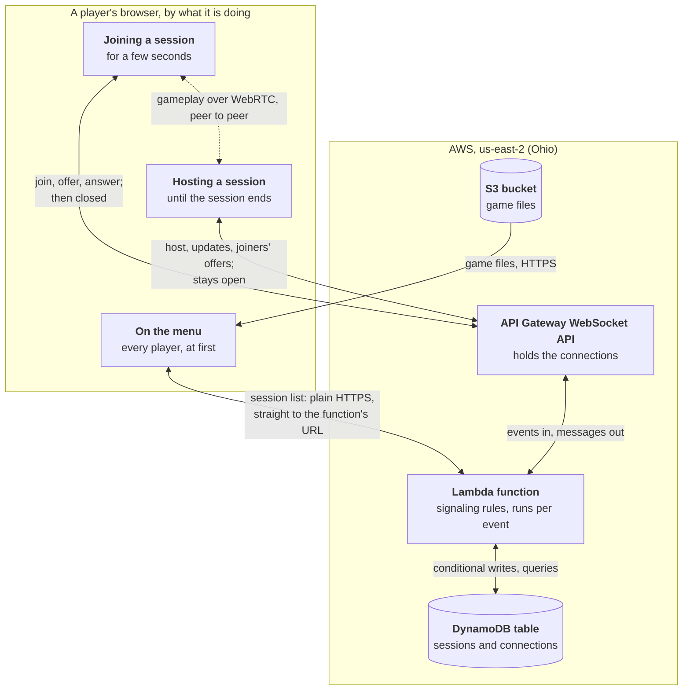

# Backend

What CheeseStrike runs in the cloud, why it is shaped the way it is, and how to deploy it.

The game itself needs no server: one player's browser hosts a match and the others connect to it directly over WebRTC. Two things can't be done browser to browser, and those are the whole backend:

- **Serving the game's files**, so there is an address to open.
- **Signaling**: listing the sessions that are open, and passing the WebRTC handshake between a host and each player who joins, since two browsers can't find each other unaided.

It runs on AWS in `us-east-2` (Ohio), and is built so that nothing runs, or costs anything, while nobody is playing.

## How it fits together



The three boxes at the top are one browser at different moments, not three kinds of player. Everyone starts on the menu; clicking a session makes them a joiner for a few seconds, and clicking "Host a session" makes them a host. Once a joiner is connected to their host, they talk to nothing in AWS at all.

| Piece | What it does |
|---|---|
| **S3 bucket** | Holds the game's web build, readable by anyone. Its address is where players go. |
| **Lambda function** | All of the signaling rules (`signaling/core.py`), in Python. It is called once for each thing that happens and remembers nothing in between. |
| **The function's URL** | A setting on the function, not a separate service: it gives the function a public HTTPS address, which is how the menu reads the session list. |
| **API Gateway WebSocket API** | Holds the open WebSocket connections, which a function can't do, and calls the function when one connects, sends a message or disconnects. |
| **DynamoDB table** | Sessions and connections, since the function remembers nothing itself. |

## Who connects to what, and for how long

Holding a connection open is the one thing here that costs money in proportion to players, so the design holds as few as it can: one for each session, and none for each player.

| A browser that is… | Connects to | For |
|---|---|---|
| on the menu | nothing. It fetches the session list over HTTPS when the menu opens, when Refresh is clicked, and every 15 seconds while the menu is showing. | — |
| joining | the WebSocket API, to send `join` and exchange offer, answer and candidates with the host | a few seconds, until it is connected to the host |
| in a match | only its host, over WebRTC | — |
| hosting | the WebSocket API, since a player may ask to join at any moment | as long as the session is open |

Three things follow from players not staying connected:

- **The host counts the players.** The server can't see who is in a match, so the host tells it (`update`) whenever someone joins or leaves, and that is the number in the list.
- **A player asks whether their host has gone.** When a player stops hearing from the host, the game asks over HTTPS whether the session is still open. Two answers of "no" in a row, with the host still silent, mean the host has left for good; anything else means it may only be stalled, and the player waits.
- **A host reconnects.** AWS closes every WebSocket after two hours, and one that has been quiet for ten minutes. A host pings every four minutes, and whenever its connection drops it connects again and takes its session back (`resume`) with a secret token it was given when it hosted. While it is away, for a second or so, the session is left out of the list and can't be joined; the match itself is unaffected, since that is browser to browser.

The full protocol is at the top of `signaling/core.py`.

## Many copies at once

On AWS many copies of the function run at the same moment, so nothing can rely on being the only one deciding. Whatever has to happen exactly once is a single *conditional write* to DynamoDB, which applies it only if a condition still holds and tells the loser:

- **A session's code**: "keep this session only if no session has this code." Two hosts given the same code at the same instant can't both get it; one tries another.
- **Who a session's host is**: changes to a session carry "only if this connection is still its host", so a connection that has been replaced can't alter or close the session its host has since taken back.
- **Taking a session back**: "only if the token matches."

The per-address limits (connections and sessions) are counted by query instead, and so can overshoot by one or two under a deliberate race. That is fine for a limit whose job is to stop one machine opening thousands.

## The same rules in two places

The rules are written once, in `signaling/core.py`, free of how messages travel and where sessions are kept. Two things run them:

| | Carries messages | Keeps sessions |
|---|---|---|
| **Development and tests**: `signaling/local/server.py` | one Python process, WebSocket and HTTP on one port | in memory (`signaling/local/memory_store.py`) |
| **AWS**: `signaling/cloud/aws_lambda.py` | API Gateway and the function's URL | DynamoDB (`signaling/cloud/dynamo_store.py`) |

Each side has a folder of its own, `signaling/local/` and `signaling/cloud/`, beside the rules they share. The function AWS runs holds only `signaling/cloud/` and `signaling/core.py`, which the deploy puts together in `build/lambda`, so its code in the Lambda console is just those three files. The tests stay in `signaling/`.

So everything is developed and tested without AWS. The game finds its server through `game/net/backend_urls.gd`: a deployed page has the two AWS addresses written into it, and a page with nothing written looks on port 9080 of the machine that served it.

## Limits

| Limit | Value | Where |
|---|---|---|
| Players in a session | 16 | `signaling/core.py` |
| Sessions in the list | 50, newest first | `signaling/core.py`. Any session can still be joined by its code. |
| Connections from one address | 32 | `signaling/core.py` |
| Sessions hosted from one address | 8 | `signaling/core.py` |
| Messages a second, over everyone | 200, in bursts of 400 | the WebSocket stage in `infra/template.yaml` |
| Message size | 32 KB a frame, 128 KB a message | API Gateway's own |

## What it costs

Estimates, from AWS's published prices in 2026; check them before relying on them. Assuming about eight players to a session:

| Players online at once | Host connections | A month |
|---|---|---|
| 100 | 13 | within the free tiers |
| 1,000 | 125 | about $1.50 |
| 10,000 | 1,250 | about $15, if sustained around the clock |

- **Connections** are most of it: about $0.25 for a million connection-minutes. A host connected for a whole month costs about a cent.
- **Session list fetches** each run the function: roughly $0.30 a million.
- **DynamoDB** is billed by the request, and requests only happen on hosting, joining and list fetches.
- **Game downloads** from S3 are free up to 100 GB a month, then about $0.09 a GB. Uploading compresses the engine, which is most of the download.

Set a budget alert (step 2 below) so that a surprise is an email, not a bill.

## What it doesn't do yet

- **No relay (TURN) server.** Players whose networks block direct connections, which is common on mobile data, can't connect to a host. A relay costs bandwidth for every such player, so it is a decision of its own.
- **No custom domain.** The game is at the bucket's own address. A domain can be pointed at it later.
- **No per-player message limit on AWS**, only the ceiling over everyone. The development server has one, per address.

## Deploying

### Once, in the AWS console

1. **Sign in** and switch the region, at the top right, to **US East (Ohio)**.
2. **Set a budget alert.** Billing and Cost Management → Budgets → Create budget → a monthly cost budget of about $5, with an email alert.
3. **Allow a public bucket.** S3 → *Block Public Access settings for this account*. "Block public and cross-account access to buckets and objects through any public bucket or access point policies" and "Block public access to buckets and objects granted through new public bucket or access point policies" must be off, or the game's bucket can't be made readable.
4. **Check the Lambda limit.** Service Quotas → AWS Lambda → *Concurrent executions*. New accounts can start at 10; ask for 1,000. It is free, and only matters under load.
5. **Choose who deploys.** The deploy runs with the permissions of whoever is signed in to the console, so sign in as an administrator user (IAM, or IAM Identity Center) rather than the account's root user, which no policy can limit. No access key is needed.

### Once, on the machine that deploys

Install the [AWS CLI](https://docs.aws.amazon.com/cli/latest/userguide/getting-started-install.html) and the [SAM CLI](https://docs.aws.amazon.com/serverless-application-model/latest/developerguide/install-sam-cli.html), then:

```
aws configure set region us-east-2
pip install "boto3[crt]"
```

`[crt]` is what lets the deploy script use a browser sign-in, below.

### Each time you sit down to deploy

```
aws login
```

It opens the browser to sign in to the console, and gives the CLI credentials that expire and refresh on their own, so no permanent key is kept on the machine. `aws sts get-caller-identity` shows who it is signed in as.

### Each time

```
python infra/deploy.py
```

This creates or updates everything in `infra/template.yaml`, exports the game, and uploads it with the backend's addresses written into its page. It ends by printing the address to play at. `python infra/deploy.py backend` and `python infra/deploy.py game` do one half each.

To remove everything: empty the game bucket, then `sam delete --stack-name cheesestrike --region us-east-2`.

### After the first deploy

The tests imitate AWS; they don't reach it. So the first deploy is the first time this runs on the real thing: play through the *Deployed game* section of the [manual tests](manual-tests.md).
